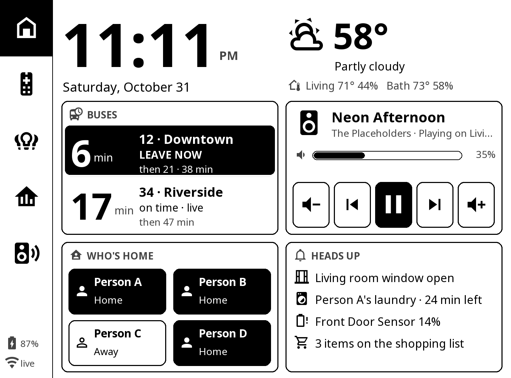
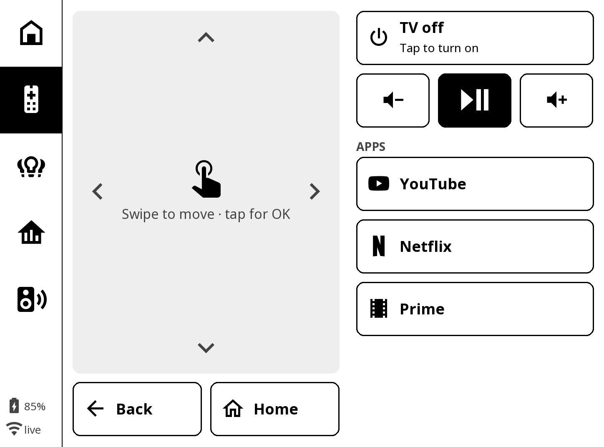
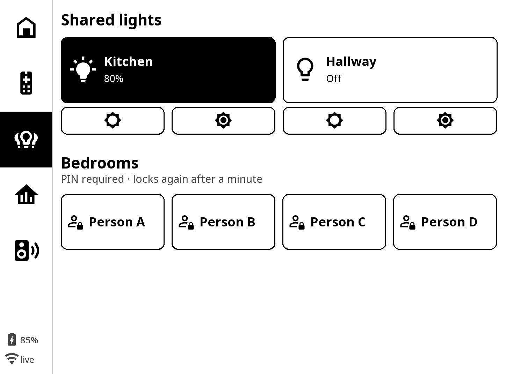
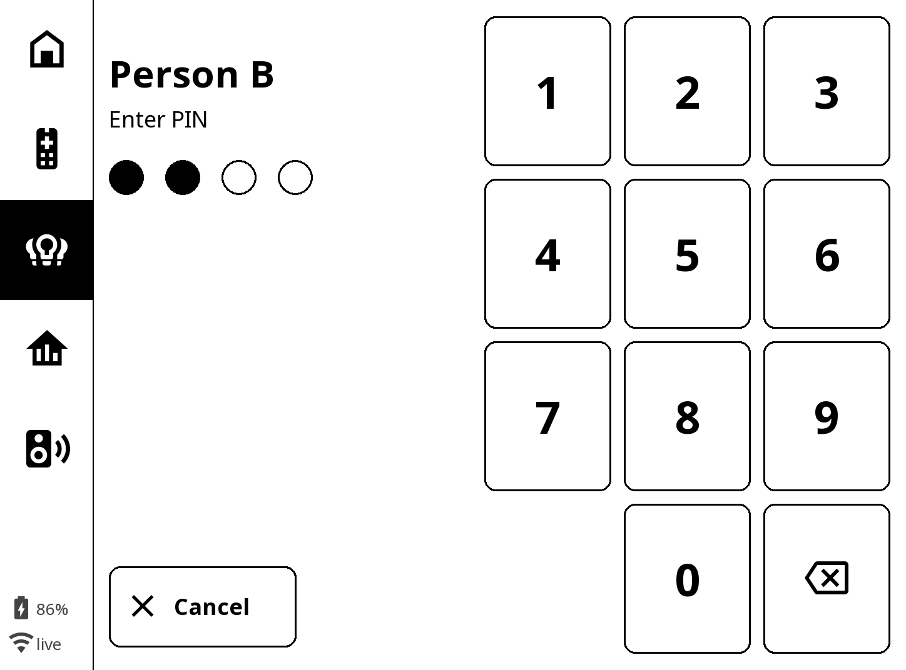
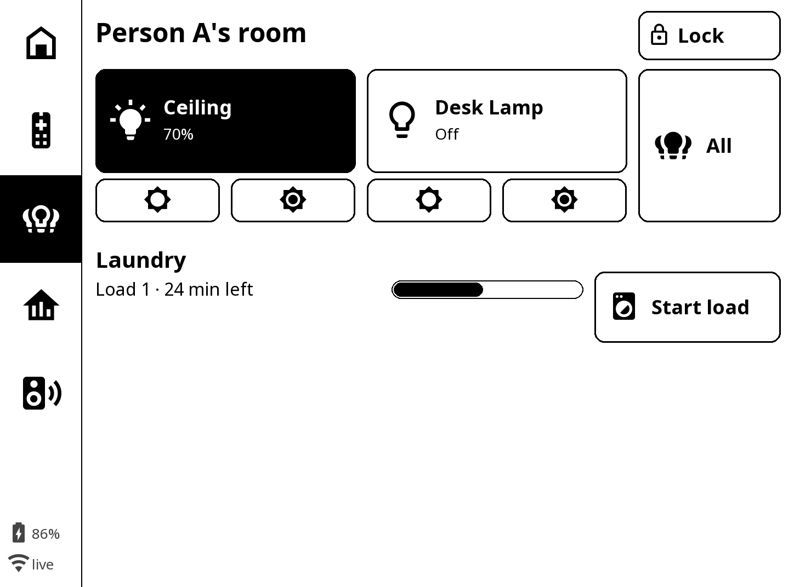
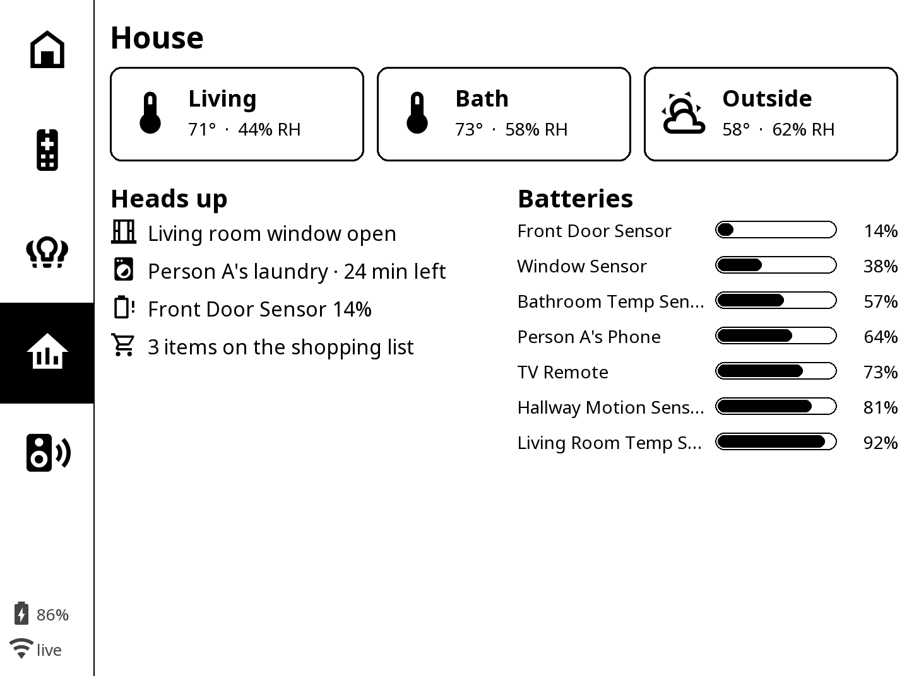
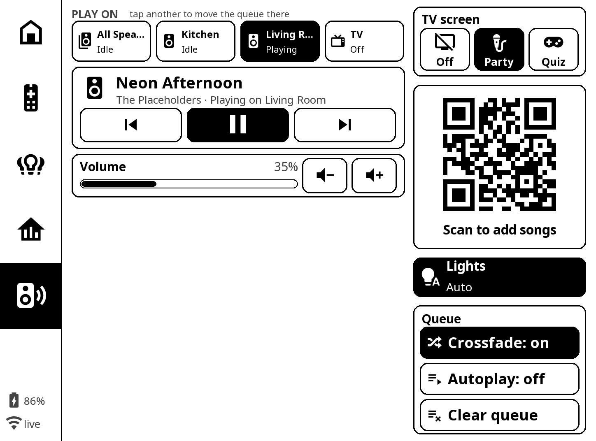
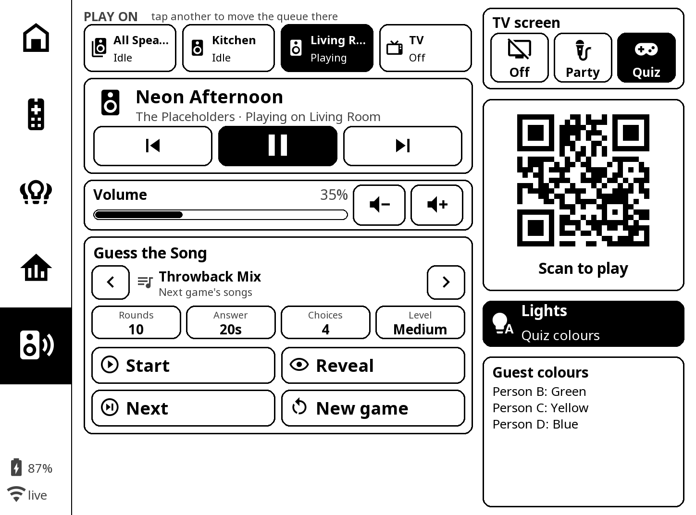
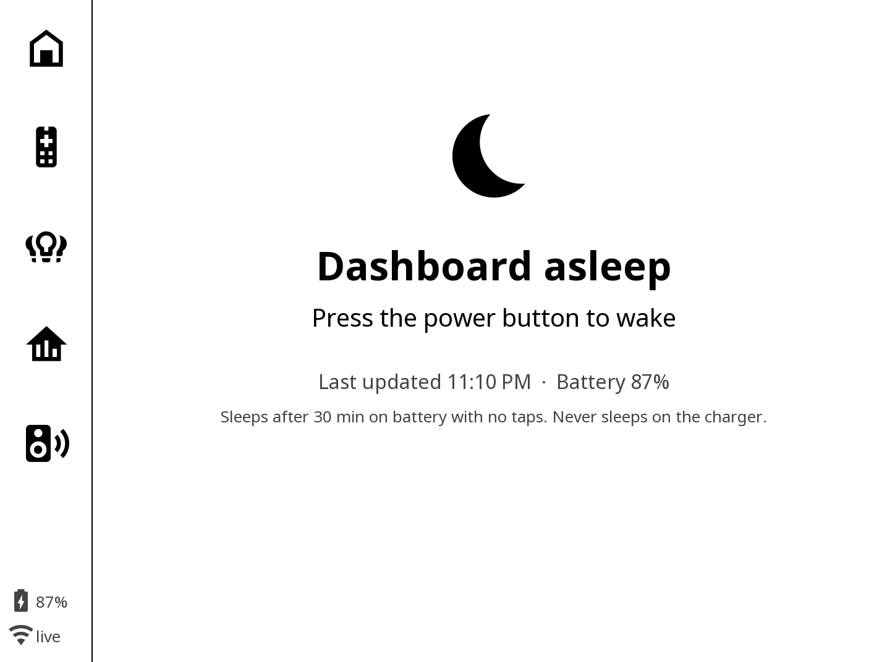
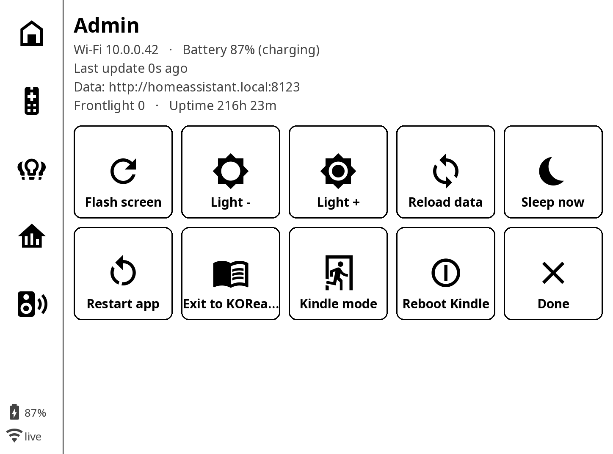

The first version of my Kindle dashboard was a screenshot. A container rendered a Home Assistant dashboard in headless Chromium, converted it to a grayscale PNG, and the Kindle downloaded it on a timer. It worked, it was read-only, and it looked like what it was: a picture of a web page.

The current version is a KOReader plugin, about 10,000 lines of Lua, that draws its own pages, talks to Home Assistant directly and runs the shared controls for the whole apartment. This post is about the constraints that shaped it.

_Names, bus routes, songs and network details in the screenshots are placeholders._

## Table of contents

## Why a Kindle at all

E-ink is the right display for a wall: readable in sunlight, invisible at night, and it draws nothing while the image is static. A 2024 Kindle is cheap, has a touchscreen and a frontlight, and once jailbroken runs Linux with KOReader on top.

The catch is that e-ink punishes everything a normal UI does. Full refreshes flash black. Partial refreshes leave ghosting. Polling a server keeps the Wi-Fi radio awake. And the people using it are four flatmates who want to turn off the kitchen lights, not debug a kiosk.

## What's on it

Five pages sit in the left rail, plus a hidden Admin page.

**Home** is the screen people glance at on the way out: the time, weather and indoor climate, the next two buses with a LEAVE NOW banner when it's time to go, whatever is playing, who's home, and a heads-up list for anything that needs attention (a window left open, a laundry load finishing, a sensor battery running low, the shopping list).

**Remote** replaces the TV remote that always goes missing. The grey area is a touchpad: swipe to move, tap for OK.

**Lights** splits shared spaces from bedrooms. Kitchen and hallway are open to anyone. Each bedroom is behind its owner's PIN and locks itself again after a minute.

Behind the PIN, a room has its own lights and that person's laundry timer. Starting a load from here is what feeds the "laundry · 24 min left" line on Home, and the notification goes to whoever started it.

**House** is the maintenance view: temperature and humidity per room, the heads-up list, and every battery-powered sensor sorted from lowest charge up, so the one about to die is always first.

**Party** runs the apartment's speakers through Music Assistant. Pick where music plays and tapping another speaker moves the queue there. The TV can show a party screen with a QR code guests scan to add songs, or a guess-the-song quiz.

## Constraint 1: refresh only what changed

Every page paints into an offscreen buffer. Before pushing to the screen, the plugin diffs the new buffer against the last one in 64 px tiles and refreshes only the tiles that changed. When the clock ticks from 11:10 to 11:11, two digits refresh, not the page. When a bus ETA drops from 7 to 6, that number refreshes and nothing around it flickers.

Partial refreshes accumulate ghosting, so every 40 partials the panel does one full flash to clean up. It's the same trade-off as compaction in a database: cheap incremental writes, with a periodic expensive pass to pay down the debt.

## Constraint 2: one request per poll, and poll less

Fetching 40 entities with 40 API calls would keep the radio busy and leave the screen showing a half-updated state. Instead the plugin sends one `POST /api/template` per poll: a Jinja template that Home Assistant renders server-side into a single compact JSON object with every entity the panel watches. One round trip, one consistent snapshot.

The poll rate adapts to whether anyone could care:

| Situation                                                              | Poll interval |
| ---------------------------------------------------------------------- | ------------- |
| Media playing, a bus within 15 minutes, or someone touching the screen | 5 s           |
| Idle                                                                   | 20 s          |
| Night (23:00 to 06:00)                                                 | 60 s          |

On battery, after 30 minutes without a tap, it draws a "Dashboard asleep" page with the last update time and the battery level, then suspends. E-ink holds that page at zero power. On the charger it never sleeps.

## Constraint 3: four people, one screen, some privacy

Shared spaces (kitchen lights, the TV, the speakers, bus times) are open to everyone. Each bedroom's lights sit behind a 4-digit PIN that lives in a Home Assistant text helper, so changing a PIN never means redeploying the Kindle. The panel caches the last PINs it saw, so bedrooms still unlock when Home Assistant is down.

## Constraint 4: nobody can brick it

A device on a wall that only one person knows how to fix is a liability. So:

- **Nothing on the root filesystem changes** except one upstart job. On boot it stops about 30 Amazon services (sync, telemetry, store, Alexa pieces) for the session only; a reboot restores every one of them.
- **A crash guard**: more than five launches in ten minutes and the start script backs off and returns the stock Kindle UI instead of boot-looping.
- **An escape hatch**: Admin, then "Kindle mode", writes a flag file and quits to the normal Kindle. Deleting that file from the USB drive brings the kiosk back.
- **Deploys copy only changed files.** The Kindle's user partition is FAT, and deleting the memory-mapped icon font under a running KOReader kills it with SIGBUS. I learned that one the hard way.

The Admin page puts all of that one tap away: force a full flash, reload data, sleep, restart the app, drop back to KOReader or the stock Kindle, or reboot.

## What I'd tell anyone building a device for other people

- Design for the display's physics first. E-ink, battery and radio set the architecture; the UI comes after.
- Batch reads into one consistent snapshot rather than many small calls.
- Keep configuration (PINs, entity ids) on the server, so changes don't require touching the device.
- Every kiosk needs a way back to stock that a non-technical person can trigger.

None of this is specific to Kindles. It's the same set of rules as any client running somewhere you can't reach: minimise round trips, make updates incremental, keep state server-side, and always ship the rollback.
